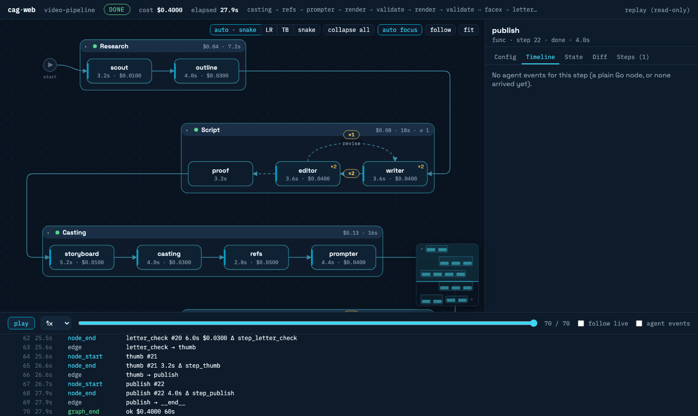

# claude-agent-go

[](https://github.com/tggo/claude-agent-go/actions/workflows/ci.yml)
[](https://pkg.go.dev/github.com/tggo/claude-agent-go)
[](https://goreportcard.com/report/github.com/tggo/claude-agent-go)
[](./LICENSE)

**Build, run, debug and test Claude Code agents from one typed Go API: locally,
in containers, or across a fleet of machines.**

`claude-agent-go` drives the `claude` binary as a subprocess. It does **not**
reimplement the agent loop, so you get the upstream models and tools for free. On
top of the CLI it adds:

- **Core client.** One-shot and interactive runs, in-process Go tools,
  permission and hook callbacks, inline subagents, streaming, retries with cost
  accounting.
- **Execution graphs.** Plan, code, review and fix loops, parallel fan-out, human
  review, and **durable runs** that survive a crash (`Recover`, `Fork`).
- **A debugger.** `graphweb`, a live and replay web UI for graph runs, plus
  recordings you can replay offline and free.
- **Evals and a test kit.** Trajectory matching, ROUGE, LLM judges, pass@k, user
  simulation, fake CLI binaries, stream invariants, golden replays.
- **Remote execution.** Local, `docker exec`, `docker run` and `ssh` transports
  that really stop the remote agent on cancel, with a preflight check.
- **Safety.** A rule-based permission policy, a bearer-token MCP server, spend
  caps, fuzz-tested parsers.

```go
// one line moves the agent off your laptop:
r := runner.New(runner.WithTransport(transport.SSH{Host: "gpu-box"}))
res, _ := r.RunJSON(ctx, runner.Input{Prompt: "Run the test suite and summarize failures."})
```

- **Zero external runtime dependencies** beyond the official MCP Go SDK (used
  only by `tools`). testify is test-only. Heavy integrations live in separate
  modules (`otel/`, `temporal/`).
- **Behaviorally verified** against the real `claude` binary: integration tests
  assert effects (a denied tool that does not write, a subagent whose prompt
  reaches the answer, an ssh/docker run that actually reaches the binary).
- **>90% unit coverage** across every substantive package; 22 fuzz targets.

Contents: [Install](#install) · [Quick start](#quick-start) · [Core](#core) ·
[Graphs](#graphs) · [Debugging](#debugging) · [Evals](#evals) ·
[Testing your agents](#testing-your-agents) · [Transports](#transports) ·
[Observability](#observability) · [Examples](#examples)

## Install

As a library (Go 1.27+):

```sh
go get github.com/tggo/claude-agent-go@latest
```

Or the `cag` CLI, to run agents and inspect runs without writing Go:

```sh
go install github.com/tggo/claude-agent-go/cmd/cag@latest

cag run --transport ssh --host gpu-box "run the test suite and summarize failures"
cag fleet examples/cag/fleet.yaml        # a batch across a worker pool, from YAML
cag trace runs/ --open                   # HTML view of recorded runs
cag web --replay runs/journal.jsonl      # graph debugger on a recorded run
cag runs ./checkpoints                   # durable graph runs: running/crashed/paused/done
```

Both need the [`claude`](https://docs.claude.com/en/docs/claude-code) CLI on
`PATH` (2.1.196 or newer) and valid credentials.

## Quick start

```go
r := runner.New(runner.WithModel("sonnet"))
res, err := r.RunJSON(ctx, runner.Input{Prompt: "Summarize this repo in one line."})
if err != nil {
    log.Fatal(err)
}
fmt.Println(res.ResultText, res.TotalCostUSD, res.SessionID)
```

Try the examples: `go run ./examples/basic -prompt "Say hi"`.

| Package | What it does |
|---|---|
| `runner` | One-shot runs: `Run`, `RunJSON`, `RunStream` (+ `ProgressFunc`), retries, plugins, preflight. |
| `client` | Interactive multi-turn session and the control protocol (permissions, hooks, agents, skills). |
| `tools` | Expose Go functions to the agent as MCP tools, in-process; untyped or typed with schema inference. |
| `permissions` | Ordered allow/deny/ask rules for `can_use_tool`, in Claude Code's pattern syntax. |
| `graph` | Execution graphs: loops, fan-out, interrupt/resume, human review, durable runs, observers. |
| `graphweb` | Live and replay web UI for graph runs. |
| `eval` | Agent evals: trajectories, ROUGE, judges, pass@k, user simulation, `go test` integration. |
| `recording` | JSONL run recordings and `ReplayTransport` for offline replay. |
| `clitest` | Fake `claude` binaries for your own tests. |
| `claudecli` | Output types and parsers; `CheckInvariants` for stream sanity. |
| `transport` | How the binary is launched: local, `docker exec`, `docker run`, `ssh`; teardown and preflight. |
| `fleet`, `budget` | A worker pool over git worktrees; cross-run spend tracking. |
| `mcp`, `workspace`, `signal` | MCP config files, project/worktree dirs, marker-agnostic outcome detection. |
| `otel/` (own module) | OpenTelemetry adapters for runner and graph observers. |

## Core

### Runner: one-shot runs

`Run` returns text, `RunJSON` adds metadata (cost, tokens, session, turns), and
`RunStream` calls you back for every event. A stream that ends without a `result`
event comes back as `*runner.TruncatedStreamError` with the session ID and the
partial text, and `RunStreamWithRetry` with `RetryPolicy{Resume: true}` continues
that session via `--resume` instead of starting over.

Transient failures (rate limits, `overloaded`, 5xx, timeouts) are retried with
exponential backoff that honors `retry-after`. The cost of **every** attempt is
accumulated into `Result.TotalCostUSD`, and `MaxSpendUSD` stops retrying once the
cumulative spend hits the cap:

```go
res, err := r.RunJSONWithRetry(ctx, in, runner.RetryPolicy{
    MaxAttempts: 4,
    MaxSpendUSD: 0.50, // never spend more than $0.50 across retries
    OnRetry: func(ri runner.RetryInfo) {
        log.Printf("attempt %d failed; spent $%.4f so far", ri.Attempt, ri.SpentUSD)
    },
})
// res.Attempts, res.TotalCostUSD (cumulative across all attempts)
```

### Client: interactive sessions

```go
c, _ := client.New(ctx, client.Config{Model: "sonnet"})
defer c.Close()

c.Query(ctx, "Remember the number 7.", nil)
t2, _ := c.Query(ctx, "What number did I say?", nil) // t2.Text recalls "7"
```

`client.Config.OnAskUser` answers the CLI's built-in `AskUserQuestion` tool from
your code (Slack, a web form, stdin via `client.AnswerFromStdin`).

Inline subagents are defined from Go, no `.claude/agents` files:

```go
c, _ := client.New(ctx, client.Config{
    Agents: map[string]client.AgentDefinition{
        "security-reviewer": {
            Description: "Reviews diffs for vulnerabilities.",
            Prompt:      "You are a security auditor. Be terse.",
            Tools:       []string{"Read", "Grep"},
            Model:       "opus",
        },
    },
})
```

### Tools: your Go functions as MCP tools

The agent calls your Go functions during a run, with no separate server to deploy.
The in-process MCP server requires a random bearer token (401 otherwise);
`Config()` carries it for you.

```go
reg := tools.NewRegistry("calc")
tools.Register(reg, "add", "Add two integers",
    func(ctx context.Context, in struct{ A, B int }) (struct{ Sum int }, error) {
        return struct{ Sum int }{in.A + in.B}, nil
    })
mcpPath, closeFn, _ := reg.ServeMCP(dir) // serves and writes the --mcp-config file
defer closeFn()

r := runner.New(runner.WithAllowedTools("mcp__calc__add"))
res, _ := r.RunJSON(ctx, runner.Input{Prompt: "What is 2+3?", MCPConfigPath: mcpPath})
```

The untyped form is `tools.Serve(name, tools.Tool{...})`; see
[`examples/tools`](./examples/tools).

### Permissions and hooks

Decide allow or deny for every tool call, in Go:

```go
c, _ := client.New(ctx, client.Config{
    Model: "sonnet",
    CanUseTool: func(ctx context.Context, tool string, input json.RawMessage, _ client.PermissionContext) (client.PermissionResult, error) {
        if tool == "Bash" {
            return client.Deny("no shell in this session"), nil
        }
        return client.Allow(), nil
    },
})
```

Or declare a policy. Rules are ordered, the first match wins, and anything
unmatched is denied:

```go
p := &permissions.Policy{
    Rules: []permissions.Rule{
        permissions.Deny("Bash(rm *)", "no deleting"),
        permissions.Allow("Bash(git status*)"),
        permissions.Allow("mcp__calc__*"),
        permissions.Ask("Write", askUser),
    },
    Remember: true,
    Audit:    func(d permissions.Decision) { log.Printf("%s %s: %s", d.Tool, d.Effect, d.Rule) },
}
c, _ := client.New(ctx, client.Config{CanUseTool: p.CanUseTool()})
```

Allow and Ask rules for Bash match only when every segment of a compound command
matches, and never with command substitution, backticks or redirections. Deny
rules also see commands nested in `$()`, backticks, subshells and groups. For file
tools, Allow never matches a path containing `..`, and Deny sees the cleaned path.
**Known limit:** a Deny rule does not see through wrappers such as `sudo`, `env` or
`xargs`, so deny the wrapper as well; do not make Deny your only barrier.

Hooks run Go logic before or after a tool and can block it:

```go
c, _ := client.New(ctx, client.Config{
    Hooks: map[string][]client.HookMatcher{
        "PreToolUse": {{
            Matcher: "Bash",
            Callbacks: []client.HookCallback{
                func(ctx context.Context, input json.RawMessage, _ string) (json.RawMessage, error) {
                    return json.RawMessage(`{"hookSpecificOutput":{"hookEventName":"PreToolUse","permissionDecision":"deny","permissionDecisionReason":"blocked"}}`), nil
                },
            },
        }},
    },
})
```

### Fleet and worktrees

Submit a batch of tasks (optionally a dependency DAG); the fleet spreads them
across a pool of workers, each task in its own git worktree, aggregating cost with
a spend cap. Give each worker a different transport and the same batch runs across
containers or hosts:

```go
f, _ := fleet.New(fleet.Config{
    Workers: []fleet.Worker{
        {Name: "host-a", Runner: runner.New(runner.WithTransport(transport.SSH{Host: "a"}))},
        {Name: "host-b", Runner: runner.New(runner.WithTransport(transport.SSH{Host: "b"}))},
    },
    Workspace:   ws, Repo: repoDir,          // one isolated worktree per task
    MaxSpendUSD: 5.00,                        // fleet-wide spend cap
    Retry:       &runner.RetryPolicy{MaxAttempts: 3},
})
rep, _ := f.Run(ctx, []fleet.Task{
    {ID: "build",  Input: runner.Input{Prompt: "..."}},
    {ID: "review", Input: runner.Input{Prompt: "..."}, DependsOn: []string{"build"}},
})
// rep.TotalCostUSD, rep.Failed, rep.Skipped
```

The `workspace` package gives any run an isolated checkout:

```go
ws := workspace.New(baseDir, nil)
wt, branch, _ := ws.CreateWorktree(ctx, repoDir, runID) // git worktree add -b temp/wt-<id>
defer ws.RemoveWorktree(ctx, repoDir, wt)

r.Run(ctx, runner.Input{WorkDir: wt, Prompt: "implement the change and commit it"})
```

See [`examples/fleet`](./examples/fleet), [`examples/worktree`](./examples/worktree),
[`examples/worktree-parallel`](./examples/worktree-parallel),
[`examples/worktree-client`](./examples/worktree-client) and
[`examples/worktree-pr`](./examples/worktree-pr).

## Graphs

`graph` composes runs and plain Go steps into any flow. Below: plan, code, review,
with a review/fix loop that exits when the reviewer approves or gives up after
three rounds. Full version: [`examples/pipeline`](./examples/pipeline).

```go
g := graph.New[State]("coding")
g.AddNode("plan", graph.Agent(planner, buildPlan, savePlan))
g.AddNode("code", graph.Agent(coder, buildCode, nil))
g.AddNode("review", graph.Agent(reviewer, buildReview, saveReview))
g.AddNode("fix", graph.Agent(coder, buildFix, countRound))
g.AddNode("docs", graph.Agent(writer, buildDocs, saveDocs))
g.AddEdge(graph.Start, "plan").AddEdge("plan", "code").AddEdge("code", "review").
    AddEdge("fix", "review").AddEdge("docs", graph.End)
g.AddConditionalEdge("review", func(s *State) string {
    switch {
    case s.Approved:
        return "docs"
    case s.Rounds >= 3:
        return graph.End
    }
    return "fix"
}, "docs", "fix", graph.End)

run, err := g.Compile(graph.WithMaxSteps(20)) // validates every edge up front
st, report, err := run.Run(ctx, State{Task: task})
```

`Compile` validates the graph (`ErrInvalidGraph`) and `MaxSteps` guards loops.
`report` holds per-node duration, cost and errors; `run.Mermaid()` draws the graph.
`WithClone` is required when the state holds reference types.

### Parallel fan-out and groups

`AddParallel` runs branches on copies of the state and merges them. `Group` labels
a set of nodes as a stage, which `graphweb` draws as a collapsible box and
`Mermaid()` as a subgraph:

```go
g.AddParallel("checks", []string{"lint", "unit", "vuln"}, mergeChecks)
g.Group("verify", "lint", "unit", "vuln", "checks")
g.GroupWith("ship", graph.GroupOpts{Label: "Ship it", Collapsed: true}, "docs", "publish")
```

### Interrupt, resume and human review

A node can stop the graph to ask a question. `Run` returns `*graph.Interrupted[S]`
with a JSON-serializable checkpoint, and `Resume` continues from it:

```go
// in a node:
return graph.Interrupt("which output format?")

// in the caller:
var it *graph.Interrupted[State]
if errors.As(err, &it) {
    st, report, err = run.Resume(ctx, it.Checkpoint, "markdown") // graph.Answer(ctx) in the node
}
```

`graph.InterruptReview(question, items)` pauses on a list of items (files, images)
for a human to approve or comment on; the node reads the verdict with
`graph.ReviewAnswer(ctx)`. A node can also publish files it produced with
`graph.EmitArtifact(ctx, graph.Artifact{Name: "p03", Path: abs, Caption: "panel 3"})`;
`graphweb` shows images as thumbnails and a run-wide gallery. Runnable demo:
`go run ./examples/artifacts`.

### Durable runs: crash, recover, fork

Give the graph a checkpoint store and every node commit is appended to a log
before the run moves on. State must survive a JSON round trip.

```go
store, _ := graph.FileStore("./checkpoints") // or graph.MemStore(), or your own (examples/pgstore)
run, _ := g.Compile(graph.WithCheckpointStore(store))

st, report, err := run.Run(ctx, State{Task: task}) // report.RunID names the run
```

After a crash, **recover** by run ID, in a fresh process. The run restarts at the
node that was in flight. If that node was an agent, its CLI session is resumed with
`--resume` and a "continue where you left off" prompt (`graph.WithRecoverPrompt`
sets your own), so tokens already spent are not wasted:

```go
st, report, err := run.Recover(ctx, runID)
```

A node that was in flight runs again from its top, so nodes with side effects must
be idempotent. `graph.IdempotencyKey(ctx)` is the same on the first attempt and on
the re-run, and different on each loop iteration; pass it to the external system:

```go
func charge(ctx context.Context, s *State) error {
    return payments.Charge(ctx, s.Amount, graph.IdempotencyKey(ctx))
}
```

**Fork** copies a run's history up to a commit, optionally edits the state, and
continues under a new run ID. That is rollback and what-if in one call, and the
original run is never rewritten (find the `Seq` with `cag runs <dir> <runID>`):

```go
st, report, err := run.Fork(ctx, "run-1", 12, "run-1-retry", func(s *State) { s.Rounds = 0 })
```

Recover and Fork refuse a graph that changed since the run started
(`graph.ErrTopologyChanged`) unless you compile with `graph.AllowTopologyChange()`.
A parallel node commits as a whole, so a crash inside a fan-out re-runs every
branch. `cag runs <dir>` lists runs as running, crashed, paused or done.
Examples: [`examples/pizza`](./examples/pizza) with `-store DIR` and
`-recover last`, and [`examples/pgstore`](./examples/pgstore), a Postgres
`CheckpointStore` over `database/sql`.

### Observers

`graph.WithObserver(obs)` takes a two-method `Observer`. It is probed with type
assertions for optional interfaces, so implement any subset: `RunObserver`,
`EdgeObserver`, `StateObserver` (state before/after each node), `ResumeObserver`,
`Gate` (block before a node: breakpoints), `AgentObserver`, `AgentInputObserver`
and `ArtifactObserver`. `StepInfo` carries `RunID` and `Attempt`, and
`run.Topology()` exposes the static graph for visualisers.

### Durable runs on Temporal

`temporal/` is a separate module (`go get github.com/tggo/claude-agent-go/temporal`),
so the core takes no Temporal dependency. Each node runs as a Temporal activity and
the control loop is a workflow. A worker crash re-runs only the node in flight, and
an agent node continues its Claude session (`--resume`) instead of starting over.
Interrupts are the `answer` signal plus a `pending` query.

```go
r, _ := g.Compile()
w := worker.New(c, temporal.TaskQueue(r), worker.Options{})
temporal.Register(w, r, temporal.WithHeartbeat(30*time.Second, 10*time.Second))

run, _ := temporal.Start(ctx, c, r, State{}, temporal.StartOptions{ID: "job-1"})
final, res, err := temporal.Wait[State](ctx, run)
// graph.Interrupt pauses the workflow; temporal.Answer(ctx, c, "job-1", "yes") resumes it.
```

State must be JSON-serializable. `graph.IdempotencyKey` is `workflowID:node:step`.
Verified by integration tests against `temporal server start-dev`, including a
worker SIGKILLed mid-activity. Limits: no continue-as-new yet, and the cost of a
failed attempt is not in the report. The engine hook is `Runnable.Step`, which
executes one node and its route so an external engine can own the loop.

## Debugging

### graphweb: live and replay web UI



`graphweb` shows a graph run as it happens, or replays a recorded one: the
topology with stages, a timeline of each node's agent events, state diffs, the
effective config of the runner (secret-free, from `runner.Effective`), costs, loop
counters and artifacts. Live runs also take breakpoints and answer interrupts and
reviews in the browser.

Above the graph, a strip shows the run's duration, cost, tokens, model calls, tool
calls and errors. Each agent node is a card with its model, a status pill, its
task, and one row per tool call. Every row has a small gantt bar on the node's
time axis, so you see both how long a call took and which calls overlapped. Click
a row to see the call's result and input in the card. A node that only observes
others (a budget guard, an inspector) can be declared with
`g.Watch("inspector", "orchestrator")`: the UI links the two with a dashed line,
and nothing changes for the run itself.

```go
srv, _ := graphweb.New(graphweb.WithJournal("run.jsonl")) // the journal makes it replayable
url, _ := srv.Start(ctx, "127.0.0.1:8799")
fmt.Println("open", url)

run, _ := g.Compile(graph.WithObserver(srv))
st, report, err := graphweb.RunInteractive(ctx, run, State{Task: task}, srv)
```

Replay later, offline, from a journal or from a durable checkpoint store:

```sh
cag web --replay run.jsonl --open
cag web --replay ./checkpoints --run <runID>
go run ./examples/pipeline -web 127.0.0.1:8799     # live, in the examples
```

The UI has snake, left-to-right and top-to-bottom layouts, automatic stages,
collapsible groups, a follow camera, a minimap and keyboard navigation. It binds to
loopback and checks the Host header; a random token guards the control endpoints.
From a store, `graphweb.NewReplayStore` rebuilds the run from state diffs, costs
and routing (the durable log carries no model messages).

### Traces and recordings

Record every stream run to JSONL, then replay it offline and free:

```go
r := runner.New(runner.WithRecorder(recording.Dir("runs/"))) // one 0600 JSONL per run
// later, offline:
replay := runner.New(runner.WithTransport(recording.ReplayTransport{Path: "runs/x.jsonl"}))
```

`cag trace runs/ --open` renders a self-contained HTML page: the graph, a per-node
summary table, and a timeline of text, thinking, tool calls with inputs, results
and durations. One recording file is a replay fixture, an eval golden and a
`cag trace` input.

## Evals

`eval` scores agents the way you would test any other code:

```go
eval.RunT(t, set, eval.RunnerAgent(r, build), eval.Criteria{
    TrajectoryThreshold: eval.Threshold(1.0),   // expected tools: Exact / InOrder / AnyOrder
    ResponseMatch:       eval.Threshold(0.3),   // ROUGE-L against the reference
    Judge:               eval.ClaudeJudge(judgeRunner, eval.JudgeSamples(3)), // median of 3
    MaxCostUSD:          0.50,
})
```

- **Trajectory:** `Exact`, `InOrder`, `AnyOrder`, `IgnoreArgs`, `ArgsSubset`.
- **Response:** ROUGE-1 and ROUGE-L, `Contains` and regex checks.
- **Judge:** `ClaudeJudge` with `JudgeSamples(n)` for a median over n runs, and
  **rubrics** (`Case.Rubrics`), each graded yes/no with a per-rubric breakdown.
- **Flaky agents:** `WithRepeats(n)` with `PassRate(f)` / `Criteria.MinPassRate`
  for pass-rate verdicts (`4/5` in the report), and `PassAtK`.
- **User simulation:** `UserSim`, `ScriptedUser`, `LLMUser`, `Conversation`, and
  `Session` / `ClientSession` for multi-turn evals.
- **Budgets and metrics:** cost, tool calls, duration; tokens, inferences, model
  vs tool time. JSON eval sets, `RunT` for `go test`.
- **Goldens:** `CaseFromRecording` turns a real run into a case, and
  `FromRecordingDir` evaluates a whole graph run, one recording per node.

## Testing your agents

Unit tests must not need credentials. `clitest` writes fake `claude` binaries:

```go
bin := clitest.FakeCLI(t,
    clitest.Init("sess-1"),
    clitest.ToolUse("t1", "Read", `{"file_path":"a.txt"}`),
    clitest.ToolResult("t1", "hello"),
    clitest.Result("done", 0.01),
)
r := runner.New(runner.WithBinary(bin))
```

`clitest.FromRecording` turns a recorded run into a fake CLI, and `clitest.Args` /
`clitest.Stdin` assert what the SDK sent. `claudecli.CheckInvariants(events)` checks
a stream for tool_use/tool_result pairing, a single final `result` and a consistent
session ID. Replay a golden recording through `recording.ReplayTransport` to test a
whole graph offline ([`examples/pipeline`](./examples/pipeline) and
[`examples/pizza`](./examples/pizza) do this). Anything that needs the real binary
goes behind `//go:build integration`.

## Transports

By default the SDK runs `claude` locally. The `transport` package launches it
elsewhere without changing any other code:

```go
// inside a running container
r := runner.New(runner.WithTransport(transport.DockerExec{Container: "agent-box"}))

// an ephemeral container per run
r = runner.New(runner.WithTransport(transport.DockerRun{Image: "my-agent:latest"}))

// on a remote host
r = runner.New(runner.WithTransport(transport.SSH{Host: "user@server"}))
```

**Teardown.** `SSH`, `DockerExec` and `DockerRun` implement `transport.Terminator`:
on cancel, timeout, plugin abort or `client.Close` the remote `claude` (and its
children) is stopped with SIGTERM then SIGKILL, not just the local proxy. Each run
gets a `CommandOpts.RunID`, exported as `CAG_RUN_ID` remotely; `DockerRun`
names its container `cag-<runid>`.

**Preflight.** Check the target before a run is paid for:

```go
r := runner.New(runner.WithTransport(t), runner.WithPreflight(true))
// or explicitly:
info, err := r.Preflight(ctx) // info.Version, info.AuthMethod
if errors.Is(err, runner.ErrClaudeNotFound) || errors.Is(err, runner.ErrCLITooOld) || errors.Is(err, runner.ErrNotAuthenticated) {
    log.Fatal(err)
}
```

`transport.Preflight(ctx, t, transport.PreflightOptions{CheckAuth: true})` is the
transport-level form. Credentials are checked locally and never against the API,
so no tokens are spent.

In-process `tools` serve on the host's localhost. Reach them from a remote agent
with `tools.Server.ConfigForHost` plus `tools.DockerHostGateway()` (docker) or
`tools.SSHReverseTunnel()` (ssh). The remote `claude` needs its own credentials.
See [`examples/transport`](./examples/transport).

## Observability

`WithObserver` emits a `RunRecord` after every run (cost, tokens, turns, transport,
duration, error), and is dependency-free. The `otel/` module bridges it to
OpenTelemetry without the core taking the dependency:

```go
// go get github.com/tggo/claude-agent-go/otel  (separate module)
r := runner.New(runner.WithObserver(otel.NewObserver(tracer)))   // one span per run
run, _ := g.Compile(graph.WithObserver(otel.NewGraphObserver(tracer))) // one span per node
```

**Plugins** hook the run lifecycle (`BeforeRun`, `EventPlugin`, `AfterRun`;
`runner.WithPlugins`). The built-in `runner.NewSpendCap(maxUSD)` refuses runs once
cumulative spend hits the cap; pair it with a per-run `WithMaxBudgetUSD`. For a
fleet-wide budget with warn/exceed callbacks, use `budget.Tracker`.

## Examples

See [`examples/`](./examples). Run one with `go run ./examples/basic -prompt "Say hi"`.

| Example | Shows |
|---|---|
| `basic` | one-shot `RunJSON` with cost/session metadata |
| `stream` | `RunStream` with a progress callback |
| `tools` | the agent calling an in-process Go tool |
| `interactive` | a multi-turn `client` session with memory |
| `permissions` | a `can_use_tool` allow/deny callback |
| `hooks` | a `PreToolUse` hook that blocks a command |
| `agents` | an inline subagent delegated to via Task |
| `worktree`, `worktree-parallel`, `worktree-client`, `worktree-pr` | isolated worktrees: one run, N concurrent agents, an interactive session, a pushed branch and PR |
| `transport` | the same agent locally, in a container, or on a remote host |
| `retry` | transient-failure retries with cost accumulation and a spend cap |
| `fleet` | tasks across workers, one worktree each, a dependency DAG and a spend cap |
| `pipeline` | a graph of real agents: plan, code, review/fix loop, docs; approval via a Go tool, pause for clarification, recordings, `cag trace`, an eval, `-web` |
| `pizza` | a human-in-the-loop order agent over mocked services; live view, `-replay`, `-web`, durable `-store` / `-recover`, a 4-scenario eval |
| `artifacts` | a graph whose nodes emit files, shown in graphweb |
| `pgstore` | a Postgres `graph.CheckpointStore` |

## Feature coverage vs the Python SDK

| Capability | Status |
|---|---|
| `query` / JSON / stream + cost/session/token metadata | yes |
| Interactive multi-turn client | yes |
| In-process tools (untyped + typed generics) | yes |
| `can_use_tool` permission callbacks | yes |
| Hook callbacks (PreToolUse decisions, blocking) | yes |
| Inline subagents + skills allowlist | yes |
| Partial / token streaming + interrupt with ack | yes |
| resume / continue / permission-mode / add-dir / settings | yes |
| External MCP servers | yes |

Every row has an integration test that asserts the behavior against the real
binary. **Go-native extras:** typed tools with schema inference, a single static
binary with no runtime, and `context.Context` cancellation throughout.

## Development

```sh
go test ./...                    # unit (fake CLI, no credentials)
go test -tags integration ./...  # real claude (needs PATH + credentials; costs money)
scripts/fuzz.sh 10s              # every native fuzz target, 10s each
```

## License

MIT
